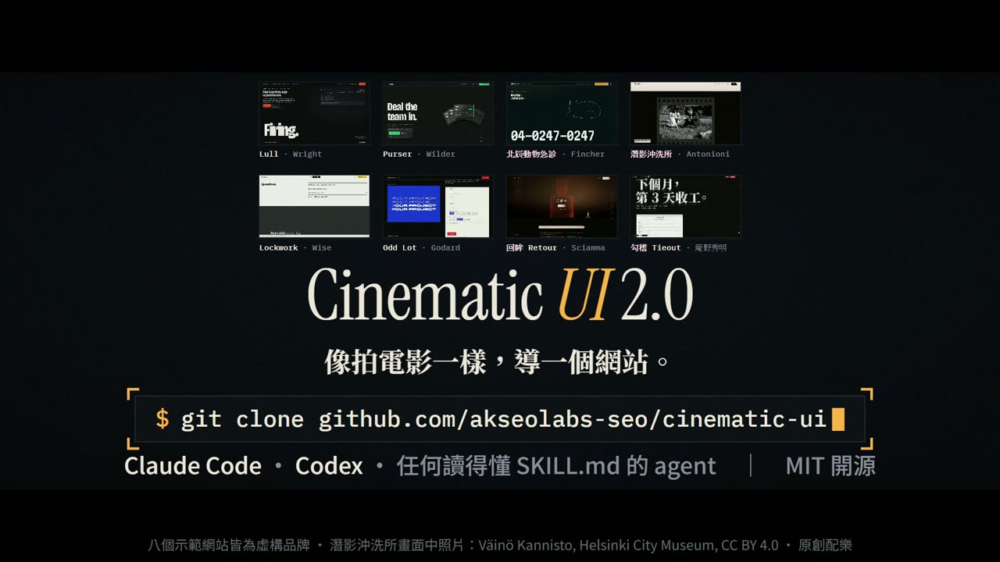
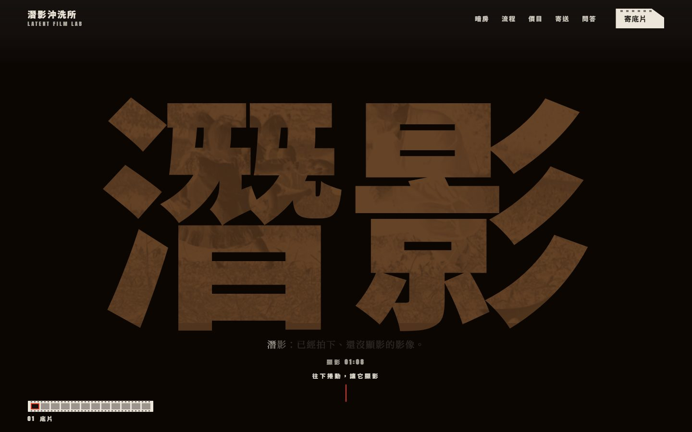
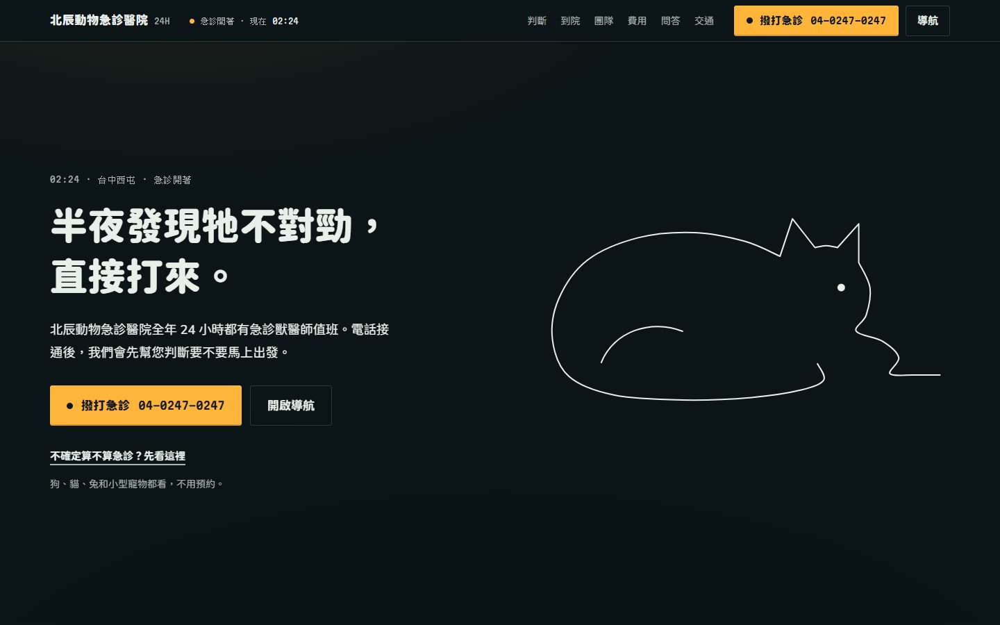
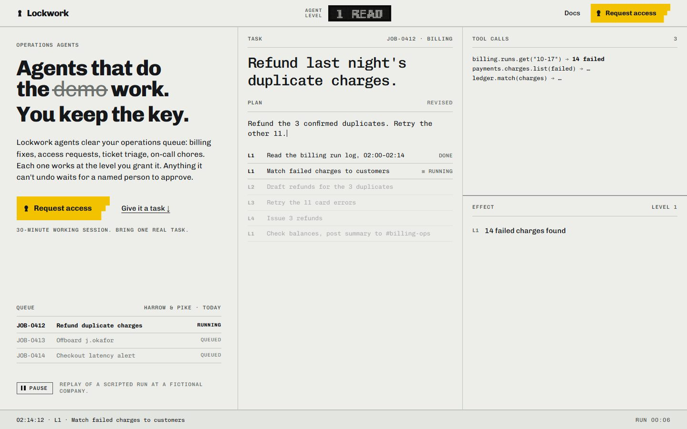
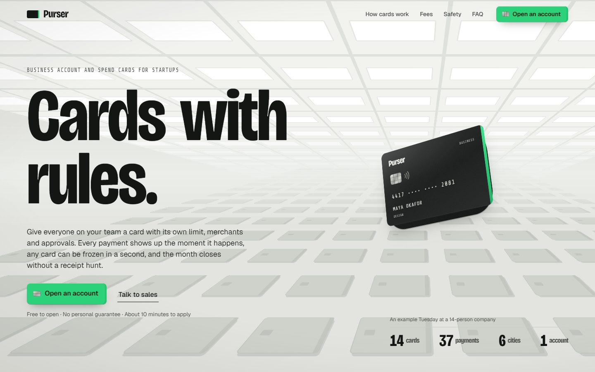
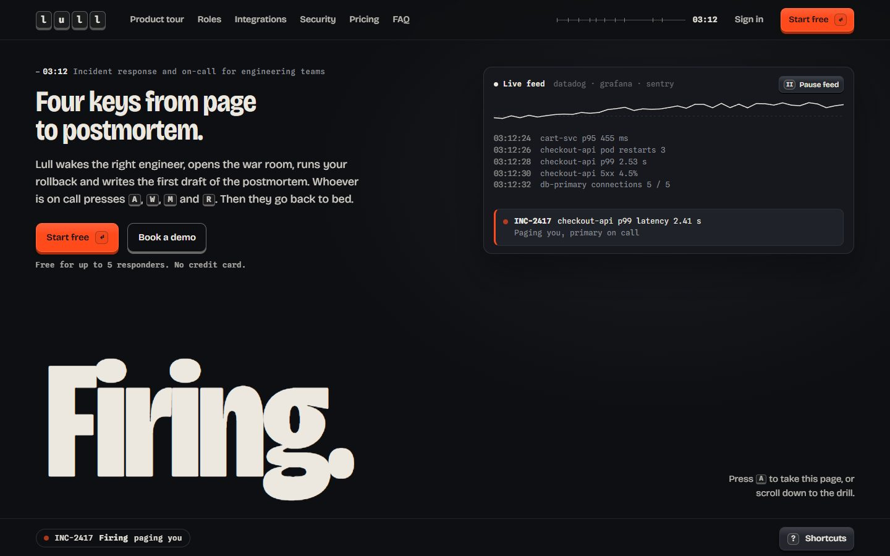
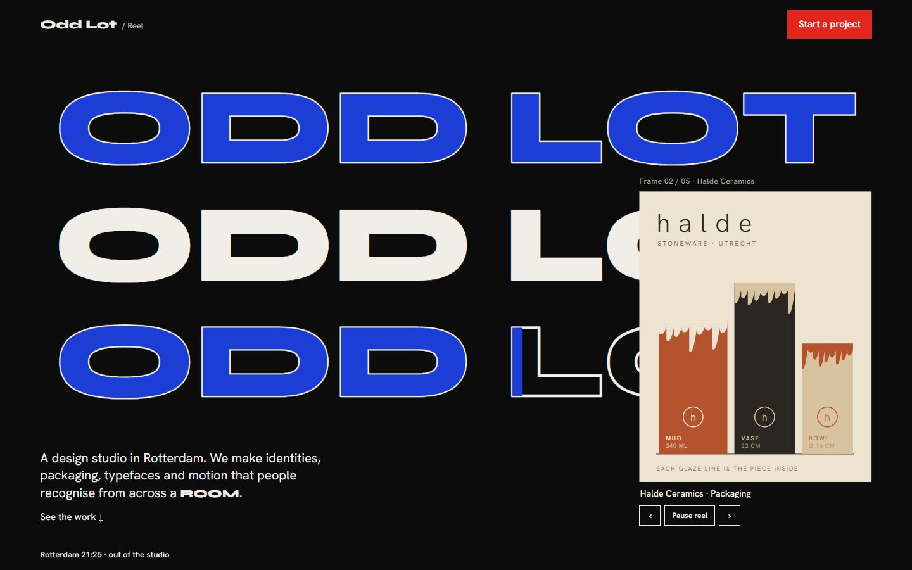
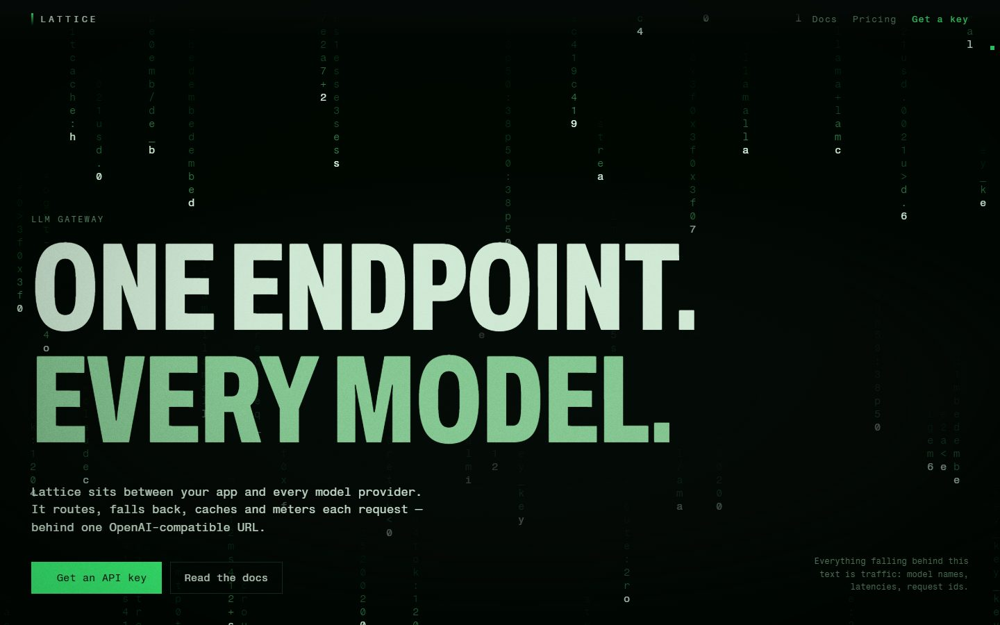
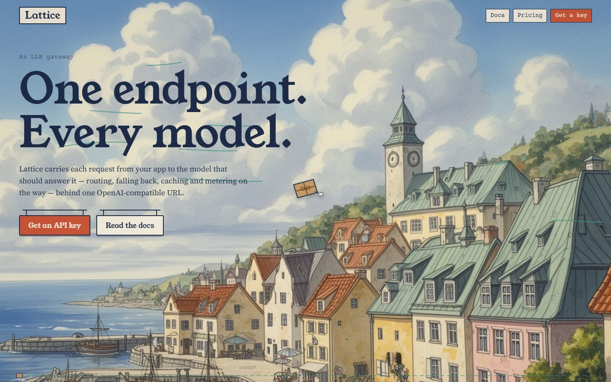
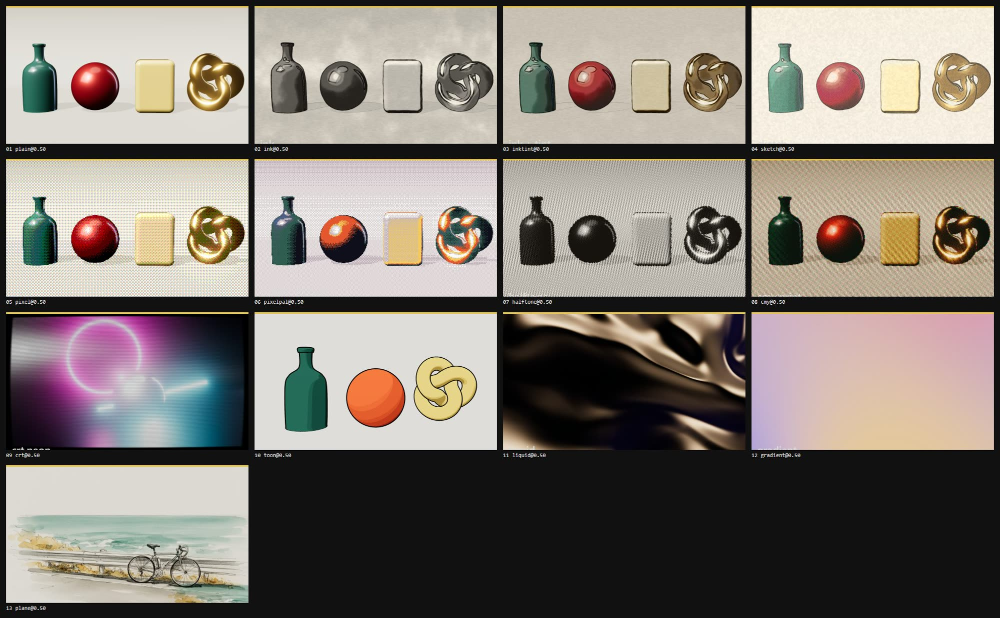

# Cinematic UI 2.0 — Director's Cut

**讓 AI 像拍電影一樣「導」網站和後台的 Agent Skill。**

AI 做的網站常常長得一樣，因為從頭到尾沒有人做過選擇。Cinematic UI 讓你的代理先選一位導演、決定畫面由什麼構成、為每個區塊寫分鏡表，再動手拍，交件前還要親自看過算出來的畫面。

**[官網](https://cinematicskill.com/zh-tw/)** · **[線上 Demo](https://cinematicskill.com/zh-tw/gallery/)** · **[文件](https://cinematicskill.com/zh-tw/docs/)** · [English](README.md) · 繁體中文

```bash
git clone https://github.com/akseolabs-seo/cinematic-ui ~/.claude/skills/cinematic-ui
```

接著告訴你的代理：`/cinematic-ui 幫一個手沖咖啡訂閱品牌做首頁`

## 宣傳片

[](https://github.com/akseolabs-seo/cinematic-ui/releases/download/v2.8.0/cinematic-ui-2.0-launch.mp4)

**[觀看宣傳片](https://github.com/akseolabs-seo/cinematic-ui/releases/download/v2.8.0/cinematic-ui-2.0-launch.mp4)** · 1 分 30 秒，MP4，有聲音

## 線上 Demo

**[cinematicskill.com](https://cinematicskill.com/zh-tw/gallery/)** 上有十個可以實際操作的網站，全部由代理使用這個 skill 做出來。品牌都是虛構的，成品是真的。點畫面就能開啟網站；每個 Demo 也附上企劃書，寫明它選了哪位導演、什麼媒材、什麼主角和調色，以及為什麼這樣選。官網的[中文作品集](https://cinematicskill.com/zh-tw/gallery/)收中文作品，[英文作品集](https://cinematicskill.com/gallery/)收英文作品。

<table>
<tr>
<td width="50%"><a href="https://cinematicskill.com/demos/latent-film-lab/"></a><br><b>潛影沖洗所</b>，底片沖洗<br>安東尼奧尼《春光乍現》<br>在暗房裡顯影的真實檔案照片 · <a href="https://cinematicskill.com/zh-tw/gallery/latent-film-lab/">企劃書</a></td>
<td width="50%"><a href="https://cinematicskill.com/demos/beichen-er/"></a><br><b>北辰動物急診醫院</b>，24 小時動物急診<br>大衛．芬奇《索命黃道帶》<br>一條連續手繪的線 · <a href="https://cinematicskill.com/zh-tw/gallery/beichen-er/">企劃書</a></td>
</tr>
<tr>
<td><a href="https://cinematicskill.com/demos/tieout/"></a><br><b>勾稽</b>，會計 SaaS<br>庵野秀明《正宗哥吉拉》<br>排版成型的會計文件 · <a href="https://cinematicskill.com/zh-tw/gallery/tieout/">企劃書</a></td>
<td><a href="https://cinematicskill.com/demos/retour/"></a><br><b>回眸</b>，香水新品發表<br>瑟琳．席安瑪《燃燒女子的畫像》<br>只靠一支燭火照明的即時 3D 玻璃瓶 · <a href="https://cinematicskill.com/zh-tw/gallery/retour/">企劃書</a></td>
</tr>
<tr>
<td><a href="https://cinematicskill.com/demos/lockwork/"></a><br><b>Lockwork</b>，AI 營運代理（英文）<br>Robert Wise《The Andromeda Strain》<br>即時排版的監控牆 · <a href="https://cinematicskill.com/gallery/lockwork/">企劃書</a></td>
<td><a href="https://cinematicskill.com/demos/purser/"></a><br><b>Purser</b>，企業費用卡（英文）<br>Billy Wilder《The Apartment》<br>單色 CSS 3D 辦公室 · <a href="https://cinematicskill.com/gallery/purser/">企劃書</a></td>
</tr>
<tr>
<td><a href="https://cinematicskill.com/demos/lull/"></a><br><b>Lull</b>，事故應變與待命（英文）<br>Edgar Wright《Baby Driver》<br>以產品介面當作整個世界 · <a href="https://cinematicskill.com/gallery/lull/">企劃書</a></td>
<td><a href="https://cinematicskill.com/demos/odd-lot/"></a><br><b>Odd Lot</b>，設計工作室作品集（英文）<br>Godard《Pierrot le Fou》<br>平塗原色與排版文字 · <a href="https://cinematicskill.com/gallery/odd-lot/">企劃書</a></td>
</tr>
<tr>
<td><a href="https://cinematicskill.com/demos/lattice-matrix/"></a><br><b>Lattice（Matrix cut）</b>，LLM 閘道（英文）<br>The Wachowskis《The Matrix》<br>由產品流量組成的字元串流 · <a href="https://cinematicskill.com/gallery/lattice-matrix/">企劃書</a></td>
<td><a href="https://cinematicskill.com/demos/lattice-kiki/"></a><br><b>Lattice（Miyazaki cut）</b>，同一個產品（英文）<br>宮崎駿《Kiki's Delivery Service》<br>水粉風格的繪製背景板 · <a href="https://cinematicskill.com/gallery/lattice-kiki/">企劃書</a></td>
</tr>
</table>

## 核心想法

網站是一部以捲軸為播放頭的電影。區塊是場景，視窗是畫格，一次捲動是一個剪接或一次運鏡；訪客是觀眾、是剪接師，還有一次機會成為參與者。

整個 skill 只靠一條規則：**借電影的機制，不借電影的戲服。** 導演風格是一組決定：鏡頭站哪、一顆鏡頭撐多久、光藏住什麼、怎麼剪、畫面由什麼構成。這些會被翻譯成結構、動態、媒材與材質。片名、角色、道具不會出現在產品的 UI 上。

## 跟一般做法差在哪

| 常見的「做高級一點」 | Cinematic UI |
|---|---|
| 選一個風格套到版型上 | 依產品的「戲劇問題」選導演，萃取 5–7 個看得到的機制 |
| 預設同一種長相（通常是亮面 3D 或玻璃） | 從電影推導**媒材**：水墨、鉛筆、賽璐珞、像素、印刷、霓虹、純字體、攝影，或 3D |
| 設計一個 hero，其餘填區塊 | 每一場都有**分鏡**：節拍、景別、鏡頭、運鏡、走位、光、剪接、長度 |
| 自己編假圖頂著 | **素材通告**：一次問清楚：你提供、免費授權圖庫、AI 生成，還是改鏡頭 |
| 元素進畫面就淡入 | 單一時間軸；場與場之間的每個剪接都是決定 |
| 「看起來不錯」 | **試片**：三種視窗的聯絡表、五格原尺寸檢查、具名修正 |
| 每個網站長得像親戚 | 作品紀錄＋骨架檢查，下一部必須和前三部不同 |

## 製作流程

| # | 階段 | 產出 |
|---|---|---|
| 1 | 企劃 | Logline 與觀眾弧線 |
| 2 | 選導演 | 試鏡三位、留下一位，萃取機制 |
| 3 | 選媒材 | 畫面由什麼構成、為什麼 |
| 4 | 選角與素材通告 | 主角與它的弧線；一則訊息問清楚需要的素材 |
| 5 | 劇本 | 所有看得到的文字 |
| 6 | 分鏡 | 形式、骨架、每一場的分鏡、觀眾的戲份 |
| 7 | Animatic | 用選定的媒材粗做整頁 |
| 8 | 正式拍攝 | 演員、場景、打光、構圖、剪接 |
| 9 | 試片 | 聯絡表、放映室、筆記、重拍 |
| 10 | 交付 | 誠實的報告：看過什麼、哪些是替身、還缺什麼 |

## 2.0 有什麼

**App 模式。** 儀表板、管理後台、控制台有自己的一套規則。播放頭變成使用者的任務，電影感只佔畫面大約十分之一：用一個只有這個產品才有的招牌畫面，取代千篇一律的 KPI 列。每條路由都要用 `app-screening.mjs` 在八種狀態、多種視窗與主題下試片。

**任何電影都能當場調研。** 沒有固定片單。指定一部片，或只給描述（例如「90 年代香港深夜、孤獨、潮濕」），`references/film-research.md` 會從有出處的訪談和參考畫面下手，每條資訊都標明來源等級。

**調色。** 電影的色彩會真正落到頁面上。`references/grades.md` 收錄 14 種有出處的 look，`grade-from-stills.mjs` 從參考影格量出調色規格，`kit/grade.js` 把它套到 DOM 網站，`screening.mjs --grade` 抓出偏離調色的畫面。

**電影的世界。** `references/art-direction.md` 把美術設計轉成卡片、按鈕、分隔線、表單和頁尾；海報的構圖語法則用在首屏、OG 圖和片頭字卡。

**媒材。** 擬真 3D 只是其中一種，不是預設。以下每一種都是 `kit/looks.js` 裡實測過的程式：



水墨、鉛筆與水彩、像素、網點與 CMY 印刷、CRT 與霓虹、賽璐珞描邊、液態、漸變光、把插畫與照片當成 2.5D 圖層、DOM 與 SVG 的手繪線抖動；另外有給「真的是實體亮面」的片子用的 HDR 3D 攝影棚，以及完全不用 canvas、只靠字體的路線。

**文字演出。** `kit/type-fx.js` 有 44 種文字演出，可以跟著捲動播放，也能由時鐘逐格精準算出，真實文字一直留在 DOM 裡。

**合法的真實影像。** `find-footage.mjs` 用分鏡描述去開放圖庫找素材（Openverse、Wikimedia Commons、Internet Archive、NASA，有免費金鑰時再加 Pixabay 或 Unsplash），拿回裁好的片段、首幀圖和 `CREDITS.md`。

## 安裝

**Claude Code**

```bash
git clone https://github.com/akseolabs-seo/cinematic-ui ~/.claude/skills/cinematic-ui
```

**Codex CLI**

```bash
git clone https://github.com/akseolabs-seo/cinematic-ui ~/.codex/skills/cinematic-ui
```

**其他 agent**：讓它讀 `SKILL.md` 即可。全部是純 Markdown、純 JavaScript 和 Node 腳本，不需要建置。

試片與算片腳本需要在你的專案裡安裝：

```bash
npm i -D playwright-core     # 使用已安裝的 Chrome 或 Edge
```

算影片才需要 ffmpeg。

## 使用

```
/cinematic-ui 幫一個手沖咖啡訂閱品牌做首頁，要 Awwwards 等級
/cinematic-ui 用小津安二郎的方式拍這個 SaaS 的 landing page
/cinematic-ui 給我三個導演方向讓我選
/cinematic-ui 幫物流團隊導一個訂單管理後台
```

預設它會直接「導」：自己做決定、製作、試片，再把成品連同企劃書給你。只有三種情況會停下來問：看不出產品是什麼、需要素材（你的，或你同意它生成）、或是要對外發布。

想把做好的網站錄成影片：

```bash
node scripts/render-film.mjs ./site --tour 30 --out tour.mp4
```

## 內容物

```
SKILL.md                     導演方法本體
references/
  directors.md               選角：約 40 位導演的機制，以及該避開的直覺選擇
  film-grammar.md            景別、鏡頭、運鏡、光、剪接、色彩、時間 → 網頁機制
  film-research.md           當場調研任何電影；從描述找候選電影
  looks.md                   選媒材、素材通告、各媒材的做法
  grades.md                  選調色；14 種復古與霓虹範例
  art-direction.md           電影的世界（UI 對照）與海報語法
  storyboard.md              logline、形式、骨架、分鏡表與範例
  production-design.md       構圖、字體（拉丁＋CJK）、色彩、材質
  award-reel.md              Awwwards 與 CSS Design Awards 得獎作的共通點
  type-motion.md             選文字演出
  vfx-threejs.md             擬真 3D：光、材質、建模、著色器、效能
  editing-and-motion.md      捲動時間軸、剪接目錄、觀眾的戲份
  screening.md               毛片、放映室、無障礙／SEO／效能檢查
  app-mode.md                儀表板、管理後台、控制台
kit/                         本身沒有長相的基礎設施，所有效果都從零開始
  reel.js  reel.css          播放頭：場景、釘住畫格、片段、設計過的剪接
  looks.js                   非擬真媒材
  grade.js  grade.html       DOM 網站調色與範例頁
  type-fx.js  type-fx.html   44 種文字演出與範例頁
  plane.js                   把即時介面當場景拍的攝影機
  stage.js  props.js         3D 攝影棚與道具庫
  app.js  fixtures.js        App 模式：路由、狀態、快捷鍵、種子資料
  site-dom.html  site.html  app-shell.html   起手用的灰階 animatic
scripts/
  screening.mjs              聯絡表＋機械檢查，任何 URL 都能用（--grade：色彩偏移）
  app-screening.mjs          路由 × 狀態 × 視窗 × 主題，附檢查旗標
  grade-from-stills.mjs      參考影格 → 色盤、黑白點、色溫、建議 look
  find-footage.mjs           從開放圖庫找照片、影片與音效
  copy-check.mjs             指定文案是否全在頁面上（含關閉 JS 時）
  render-film.mjs            網站導覽 → MP4
  generate-image.mjs         選用的圖片生成（Runware），需你同意才會用
```

## 怎麼測試的

把這個 skill 和一份客戶 brief 交給完全沒有其他上下文的全新代理。它們的摩擦紀錄、另一個模型的獨立審查，以及對其他 skill 的調查，都回饋進了文件與 kit。App 模式用同樣三份 brief 跑了三輪盲測。Kit 與腳本在 headless Chrome 下以 three 0.186、GSAP 3.15、Lenis 1.3 驗證：場景與剪接邏輯、任意順序跳播的畫格可重現、減少動態、鍵盤順序、每一種媒材、逐格算片。

## 誠實的限制

- 沒有在 Safari、Firefox、實體手機或螢幕閱讀器上驗證。流暢度無法在 headless 環境判斷。
- 程序生成的 3D 在特寫「大家都認得的真實物件」時仍然吃力。Skill 會跟你要素材、把弱的素材留在遠景，但它變不出產品照。
- 高斯潑濺只有說明、沒有實作。
- 它拉高下限、拉開變化幅度，不保證得獎。

## 致謝

建構於 [GSAP](https://gsap.com)、[Three.js](https://threejs.org) 與 [Lenis](https://lenis.darkroom.engineering)。

## 授權

MIT
